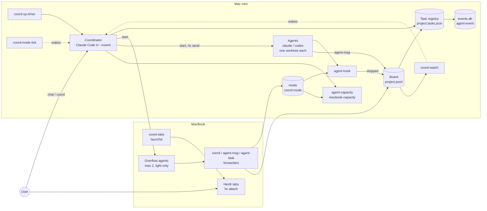

# agent-bus

Tools for running a small fleet of coding agents (Claude Code and Codex) across two machines, with a
coordinator agent that plans, delegates, gets every PR reviewed and reports back. Everything is plain
bash, Python standard library, `jq`, `git`, `gh`, and [`hc`](#requirements) for terminals across machines.

## The setup

- **Two machines.** A MacBook is the screen: the user works there and watches the agents in Herdr tabs.
  A Mac mini (`mac-mini`) is always on and does the project work. The names `macbook` and `mac-mini` are
  the `hc` machine names this repo assumes.
- **Coordinator.** A Claude Code session on the Mini, in the `hc` terminal `coordinator`, kept running
  by a systemd timer ([docs/mini-coordinator.md](docs/mini-coordinator.md)). It doesn't write project
  code. It writes task contracts, starts agents, approves plans, starts a fresh reviewer agent for each
  PR and merges only what the user pre-approved. Its rules and its `delegate` skill are in
  [docs/templates](docs/templates).
- **Agents.** One `claude` or `codex` CLI per task, each in its own git worktree and Herdr tab. They
  talk to the coordinator only through the board, and their Stop hook (`agent-hook`) wakes the
  coordinator when a turn ends without a post.
- **Board.** `agent-msg` appends JSON lines to `~/.agent-bus/<project>.jsonl`: plans, questions,
  blockers, findings, reviews, `done` (refused until `agent-msg verify` passes on the last commit).
  `coord-watch` exits on actionable posts, which wakes the coordinator within seconds.
- **Task registry.** `agent-task` keeps each project's tasks in `~/.agent-bus/<project>.tasks.json`:
  owner, agent, reviewer, files, deps, status, executions and leases. It refuses overlapping files and
  changes by a coordinator that doesn't own the task. Every change also lands in a SQLite event store
  (`agent-event`, [docs/SPEC.md](docs/SPEC.md)).
- **Modes.** `interactive`, `autonomous`, `suspended`, and `draining` while `coord off` waits for
  agents to finish ([docs/modes.md](docs/modes.md)). The user switches with `coord` or a chat phrase.
  Suspension is enforced by the tools, not by trusting the model.
- **Capacity.** `agent-capacity` allows a new agent only when memory, CPU and IO pressure, the live
  agent count and a start stagger all have room. `server-turn` takes turns on servers and
  `e2e-worktree` shares one warm e2e checkout. When the Mini is full, light tasks may overflow to the
  MacBook ([docs/macbook-overflow.md](docs/macbook-overflow.md)).



## Repository layout

| Path | Contents | Installed on |
|---|---|---|
| `bin/` | `agent-msg`, `agent-task`, `agent-event`, `agent-hook`, `agent-capacity`, `agent-metrics`, `server-turn`, `e2e-worktree`, `coord-mode`, `coord-statusline` | Mini `~/.local/bin` |
| `lib/agentbus/` | Event store, fleet registry, task lifecycle (Python standard library) | Mini `~/.local/lib/agentbus` |
| `coordinator/` | The Mini coordinator's home: `hc` and `herdr-app` stand-ins, `coord-watch`, `coord-up`, `macbook-capacity`, preamble, settings | Mini `~/coord` |
| `systemd/` | `coord-up`, `agent-probe`, `agent-prune` user units | Mini `~/.config/systemd/user` |
| `macbook/` | Forwarders, `coord-push`, `coord-tabs` and its launchd agent, the zsh `coord-watch` | MacBook `~/.local/bin` |
| `docs/` | [SPEC.md](docs/SPEC.md) (v2 event store and lifecycle), [modes](docs/modes.md), [Mini coordinator](docs/mini-coordinator.md), [MacBook overflow](docs/macbook-overflow.md), [templates](docs/templates) | |
| `COMMANDS.md` | Cheat sheet for the user | |

## Requirements

- Mini: Linux with systemd and PSI (`/proc/pressure`), bash, Python 3, `jq`, `git`, `gh`,
  `inotifywait`. MacBook: macOS with zsh, `jq`.
- `hc` (terminals addressable across machines: `hc ls/get/run/send/read/exec --on <machine>`) and the
  Herdr terminal app on the MacBook. The scripts call them as documented in the templates.
- Claude Code and/or Codex, logged in on both machines.

## Install

```bash
./install.sh --dry-run          # show what goes where
./install.sh mini               # on the Mini (the default role)
./install.sh macbook            # on the MacBook
```

Files are replaced atomically. The installer never enables systemd units or loads launchd agents, and it
keeps an existing `~/coord/CLAUDE.md` and `~/coord/.claude/settings.json`. Then:

1. Copy the [templates](docs/templates) (`coordination-rules.md` as `~/projects/CLAUDE.md`,
   `global-rules.md` as `~/.claude/CLAUDE.md`, `skills/delegate`) and replace their placeholders.
2. From the MacBook checkout, `./macbook/coord-push` installs the Mini side plus your rules and skill.
3. Enable the timers on the Mini and the launchd agent on the MacBook
   ([mini-coordinator.md](docs/mini-coordinator.md#setup), [macbook-overflow.md](docs/macbook-overflow.md#install)).
4. Per project on the Mini: `~/.agent-bus/<project>.verify` holds the command `agent-msg verify` runs.

Configuration lives in environment variables: `AGENT_BUS_DIR` (default `~/.agent-bus`), `AGENT_BUS_HC`,
`AGENT_MAX_AGENTS`, `AGENT_STAGGER_MIN`, `COORD_NAME`, `COORD_RULES`, `COORD_SKILL`. Never put
credentials in the board, the rules or this repo; the event store redacts token-like strings.

## Tests

```bash
python3 -m unittest discover -s tests -q && bash tests/agent-task-test "$PWD/bin"
```

All tests use temporary directories and a fake `hc`. The zsh watcher tests are skipped without zsh
(`AGENT_BUS_TEST_ZSH=/path/to/zsh` to point at one).
