# MacBook overflow

When the Mini is full (`agent-capacity` says DEFER for a light task), the Mini coordinator may run that
task on the MacBook instead, if `macbook-capacity` says ALLOW. The user works on the MacBook, so the
limits are strict: at most 2 coordinator agents there, only while the MacBook is connected and macOS
reports at least 30% memory free. Heavy tasks (builds, servers, Docker, e2e) never go there.

```mermaid
sequenceDiagram
    participant C as Coordinator (Mini)
    participant M as MacBook
    participant B as Board + registry (Mini)
    C->>C: agent-capacity --class light → DEFER
    C->>M: macbook-capacity (hc machine ls, hc ls, memory_pressure)
    M-->>C: ALLOW
    C->>M: herdr-app do tab.new --space macbook (hc run --on macbook)
    M->>M: coord-tabs (launchd, every minute) opens a Herdr tab: hc attach
    M->>B: agent-msg / agent-task forwarders (hc exec --on mac-mini)
    B-->>C: coord-watch wakes on plan / question / done
```

## Pieces

| File | Where | Role |
|---|---|---|
| `coordinator/bin/macbook-capacity` | Mini | ALLOW (exit 0) or `DEFER: <why>` (exit 1). |
| `macbook/agent-msg` | MacBook | Forwards to the Mini's board as `macbook/<terminal>` with `AGENT_REMOTE=macbook`. `verify` is a no-op: CI on the PR is the check, and the Mini's `agent-msg` skips the verify gate and execution lookup for these posts. |
| `macbook/agent-task` | MacBook | Runs `agent-task` on the Mini, where the registry lives. |
| `macbook/coord` | MacBook | Runs `coord` on the Mini, where the mode lives. |
| `macbook/coord-tabs` + `macbook/launchd/coord-tabs.plist` | MacBook | Gives terminals the Mini coordinator starts (itself and its agents, on either machine) a Herdr tab running `hc attach`, and closes it when the terminal is gone. |
| `macbook/coord-push` | MacBook | Installs the Mini side from this checkout plus your rules and skill. |
| `macbook/coord-watch` | MacBook | zsh watcher for a coordinator that runs on the MacBook (for example Codex). |

`agent-capacity` on the Mini counts only the Mini's own terminals (no `macbook/` addresses) and skips
`hc attach` viewer tabs, so MacBook agents and Herdr viewers never use up the Mini's slots.

## Rules for MacBook agents

The coordinator adds to the task (see `coordinator/CLAUDE.md`): work in a worktree outside the user's
checkout (`~/agent-work/<project>-<issue>` from `origin/<base>`), never change the checkout's branch,
push and let green CI be the check before `post done`, and remove the worktree once the PR is final.
MacBook agents have no Stop hook; `coord-watch` still notices when they stop. If the MacBook sleeps,
their pushed branches keep the work, and the coordinator restarts the task on the Mini.

## Install

`./install.sh macbook` copies the forwarders and helpers to `~/.local/bin` and the launchd agent to
`~/Library/LaunchAgents/dev.coord.tabs.plist` (with your `$HOME` filled in). Load it with
`launchctl bootstrap gui/$(id -u) ~/Library/LaunchAgents/dev.coord.tabs.plist`.
