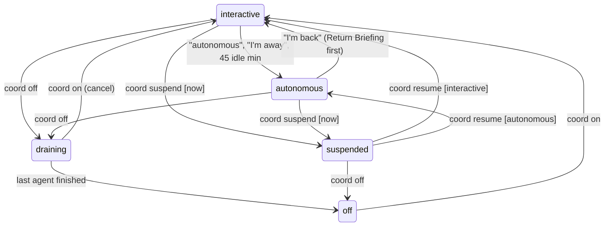

# Operating modes

The coordinator works differently depending on whether the user is around. `bin/coord-mode` holds the
mode in `~/.config/coord/mode` on the Mini (missing means `interactive`), so it survives restarts. The
user changes it with `coord` (a symlink to `coord-mode` on the Mini, a forwarder on the MacBook) or with
a phrase in the coordinator's chat. Commands: [COMMANDS.md](../COMMANDS.md). The policy the coordinator
follows is "Operating modes" in [templates/coordination-rules.md](templates/coordination-rules.md).

| Mode | Meaning | Who enforces it |
|---|---|---|
| `interactive` | The user is here. The rules as written: ask what they say to ask. | The coordinator |
| `autonomous` | The user is away. Keep the priority projects moving within daily limits; queue questions in `~/.config/coord/away.md`. | The coordinator, woken by the pacer |
| `suspended` | Everything stands down until the user says `resume`. | The tools, without Claude |
| `draining` | `coord off`: agents finish their current task, then they and the coordinator stop. | `coord-mode drain` |

## Switching

- A `UserPromptSubmit` / `SessionStart` hook (`coord-mode hook`, see `coordinator/settings.json`) switches
  the mode when the whole first line of a message is a mode phrase, alone or followed by punctuation.
  "take over the login bug" and "resume the billing work" are tasks, not switches.
- The state is changed under a `mkdir` lock, so one switch never runs twice. `suspended` and `draining`
  store the mode before them (`suspended autonomous`), so `resume` and `coord on` return to it.
- `coord` run by the user tells the coordinator what changed (`hc send`, only into an empty input line,
  so nobody's typing is disturbed).

## Pacer

`coord-mode tick` runs in the coordinator's background and wakes it by exiting: after 45 minutes
without a user message in interactive (it switches to `autonomous idle`; the next message switches back),
and every 30 minutes in autonomous for a check-in. It does nothing while suspended or draining. On a Mac
it also keeps the machine awake with `caffeinate` while autonomous.

## Suspension is enforced by the tools

Claude doesn't have to obey for a suspension to hold:

- `agent-capacity` refuses every start while the mode is `suspended` or `draining`, and fails closed when
  the mode file is unreadable.
- The Mini's `herdr-app do tab.new` refuses to start agents.
- `agent-hook turn-start` tells every agent on every prompt to stop (or, while draining, to finish its
  current task and stop).
- `coord suspend` sends each live agent a stand-down message (`now` also interrupts it); `coord resume`
  tells the same agents to continue after checking their task and the board.

## Off and on

`coord off` sets `draining`, tells the agents to finish, and starts a `coord-drain` terminal that closes
each agent once it posted `done`, `review` or a `blocker` (or sat idle 45 minutes), then stops the
coordinator, disables `coord-up.timer` and leaves `~/.config/coord/off`, so neither the timer nor a
reboot starts it again. `coord off now` does all that at once. `coord on` cancels a drain, or re-enables
the timer, starts the coordinator and lifts the suspension.
